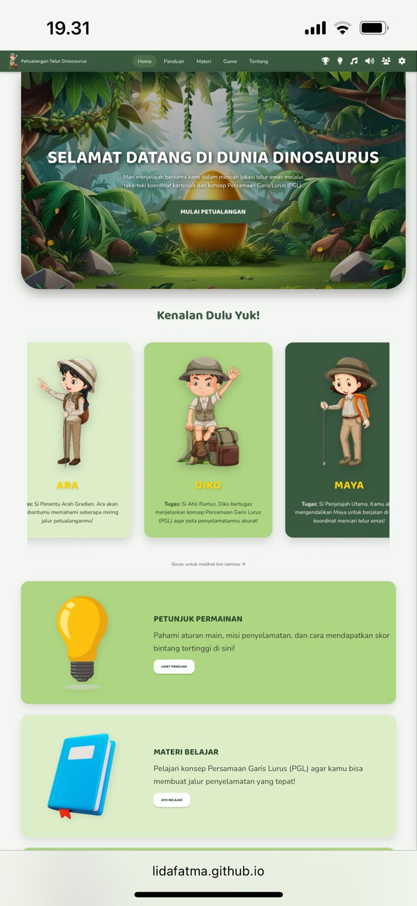

# 🦖 Dinosaur Egg Adventure

Media pembelajaran berbasis game interaktif untuk membantu siswa SMP memahami konsep **Persamaan Garis Lurus** melalui petualangan prasejarah yang seru dan edukatif.

🔗 **Demo:** https://lidafatma.github.io/Dinosaur-Egg-Adventure/

## Latar Belakang
Persamaan garis lurus sering dianggap sulit karena bersifat abstrak. Game ini mengubah latihan soal menjadi petualangan agar siswa lebih termotivasi dan memahami konsepnya secara visual.

Proyek ini menjadi dasar penelitian terpublikasi:
> Fatma, A., Nugroho, A., & Rahmawati, N. (2026). Efektivitas Media Game Edukatif terhadap Peningkatan Pemahaman Konsep Materi Persamaan Garis Lurus Siswa SMP. *Jurnal Cendekia: Jurnal Pendidikan Matematika*, 10(2), 614-626.

## Target Pengguna
- Siswa SMP (materi Persamaan Garis Lurus)
- Guru matematika yang mencari media pembelajaran interaktif

## Fitur Utama
- [isi fitur nyata, mis. level/misi, soal interaktif, umpan balik jawaban]

## Teknologi
JavaScript, HTML, CSS

## Cara Menjalankan
1. Clone repositori ini
2. Buka `index.html` di browser

## Tangkapan Layar

## Pengembang
Ade Ziyana Walidah Fatma
